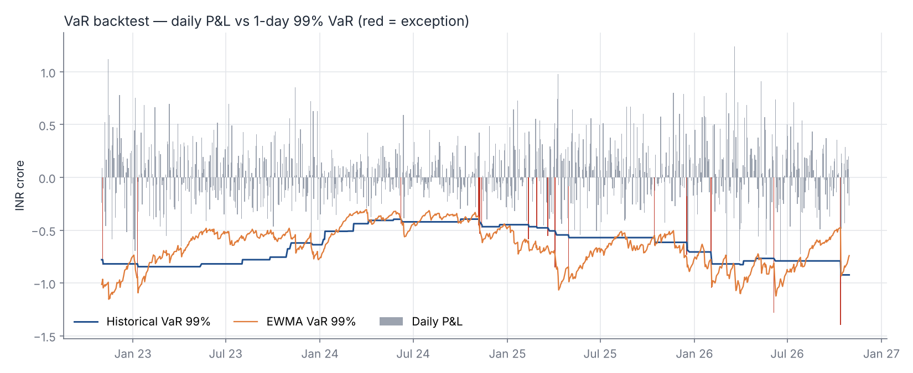
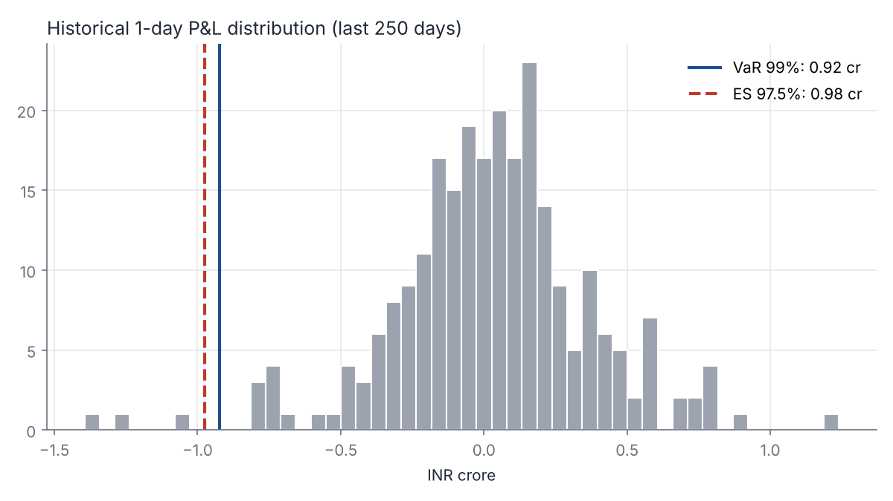
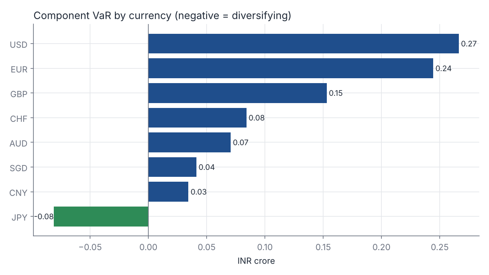
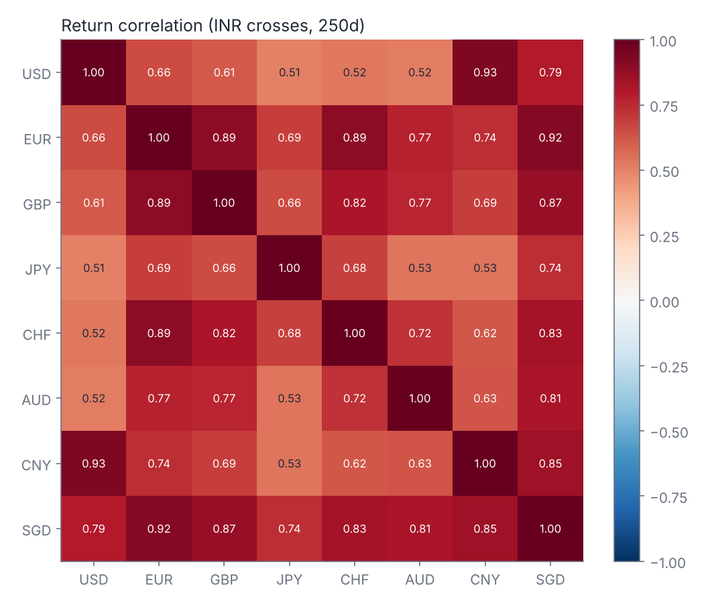
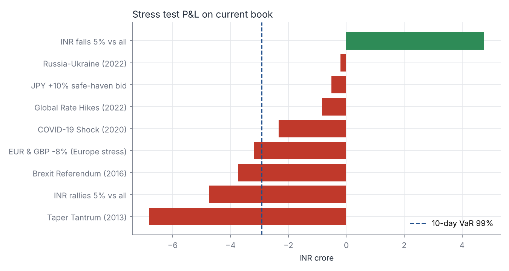
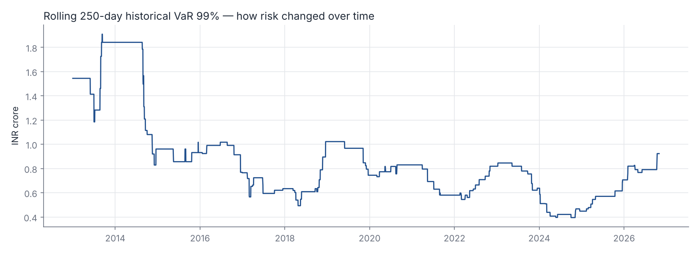

# FX Portfolio VaR & Market Data Quality Engine

A Python market risk engine for a multi-currency FX book held by an Indian bank (base currency INR).
It runs a full daily risk process: **market data quality control → VaR / Expected Shortfall → backtesting → stress testing → management report**.

**Author:** Deepanshu Verma · **As-of date:** 30 Oct 2026 · **Data:** 2012–2026 daily FX fixings

---

## Why this project

Market risk numbers are only as good as the data behind them. This project covers both halves of a market risk data analyst's job:

1. **Market data management**: sourcing, validating, remediating and documenting time-series data, with a full exception and remediation audit trail.
2. **Risk measurement**: calculating, explaining and validating VaR and Expected Shortfall the way a bank's market risk function does (Basel / FRTB conventions).

## Portfolio

Hypothetical FX book, exposures in INR crore (positive = long foreign currency vs INR):

| USD | EUR | GBP | JPY | CHF | AUD | CNY | SGD | Gross | Net |
|---|---|---|---|---|---|---|---|---|---|
| +40 | +25 | +15 | −10 | +8 | +7 | +5 | +5 | 115 | 95 |

## Pipeline

| Step | What it does | Module |
|---|---|---|
| 1. Load | Pivots raw central-bank fixings (units per USD) and builds INR cross rates | `data_quality.py` |
| 2. DQ checks | Holiday / missing fixings, invalid prices, stale prices (5+ days unchanged), outliers (rolling robust z-score vs 120-day median/MAD), calendar gaps | `data_quality.py` |
| 3. Remediation | Drops non-trading days, proxies isolated gaps with last valid price (max 3 days), logs every action | `data_quality.py` |
| 4. VaR / ES | Historical simulation, parametric (delta-normal), EWMA (RiskMetrics λ=0.94), Monte Carlo (normal and Student-t, Cholesky-correlated) | `var_models.py` |
| 5. Attribution | Euler component VaR and marginal VaR by currency | `var_models.py` |
| 6. Backtest | 1,000-day rolling out-of-sample test; Kupiec POF, Christoffersen independence, Basel traffic-light zone | `backtest.py` |
| 7. Stress | Worst 10-day historical moves (Taper Tantrum, Brexit, COVID, Russia–Ukraine, 2022 rate hikes) plus hypothetical shocks | `stress.py` |
| 8. Report | 11-sheet Excel risk report and 6 charts | `run.py` |

## Results (as of 30 Oct 2026, INR crore)

| Model | 1-day VaR 99% | 1-day ES 97.5% | 10-day VaR 99% |
|---|---|---|---|
| Historical simulation | 0.92 | 0.98 | 2.92 |
| Parametric (delta-normal) | 0.81 | 0.82 | 2.57 |
| EWMA (λ = 0.94) | 0.73 | 0.74 | 2.32 |
| Monte Carlo (normal) | 0.80 | 0.80 | 2.52 |
| Monte Carlo (Student-t, ν=4) | 0.95 | 1.02 | 3.02 |

**Backtest (1,000 days, 99% VaR, 10 exceptions expected):**

| Model | Exceptions | Kupiec POF | Christoffersen | Basel zone (last 250d) |
|---|---|---|---|---|
| Historical | 17 | Reject (p=0.04) | Reject (p=0.03) | Amber (5) |
| Parametric | 18 | Reject (p=0.02) | Reject (p=0.04) | Amber (8) |
| EWMA | 11 | **Accept (p=0.75)** | **Accept (p=0.11)** | **Green (4)** |

### Key findings

- **Fat tails matter.** Student-t Monte Carlo VaR is about 20% higher than normal Monte Carlo VaR, and historical ES is above parametric ES. FX returns have fatter tails than a normal distribution assumes.
- **Equal-weighted models react too slowly.** Historical and parametric VaR both had too many exceptions, and the exceptions clustered (failed the independence test). EWMA puts more weight on recent volatility, adapts faster, and was the only model to pass both tests and stay in the Basel green zone.
- **USD and EUR drive about 63% of VaR.** The short JPY position has negative component VaR, so it hedges the rest of the book.
- **Stress losses go well beyond VaR.** Replaying the 2013 Taper Tantrum on today's book loses INR 6.8 cr, 2.3× the 10-day VaR. A 5% INR rally across all currencies loses INR 4.75 cr. VaR alone understates tail risk.
- **Data quality:** 302 exceptions logged across 3,870 raw rows. 161 non-trading days were removed, CNY was flagged for stale prices (consistent with a managed currency), and outliers were kept for review rather than deleted, because real shocks belong in the VaR data set.

## Charts

| | |
|---|---|
|  |  |
|  |  |
|  |  |

## How to run

```bash
pip install -r requirements.txt
python run.py
```

Outputs go to `output/FX_VaR_Risk_Report.xlsx` and `output/charts/`. Positions, confidence levels, windows, DQ thresholds and stress scenarios are all set in `src/config.py`.

## Data source

Daily FX fixings from the U.S. Federal Reserve H.10 release (via FRED), redistributed as open data by [datasets/exchange-rates](https://github.com/datasets/exchange-rates) (ODC-PDDL). Raw extract: `data/raw/fx_rates_per_usd.csv`.

## Limitations and next steps

- P&L is linear (delta only). Options would need full revaluation or delta-gamma.
- 10-day VaR uses square-root-of-time scaling, which assumes i.i.d. returns.
- Next: add equity (NIFTY 50) and rates (G-Sec yield curve) risk factors, filtered historical simulation, and an FRTB-style stressed ES calibration.
